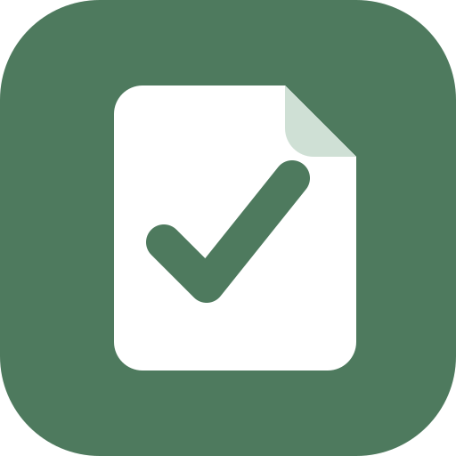

<div align="center">

  

  <h1>PSPad</h1>
  <p>A self-hosted GTD notepad that works offline, on your own hardware</p>

  <div>
    <a href="https://github.com/psp515/PSPad/actions/workflows/ci.yml">
      
    </a>
    <a href="https://psp515.com/pspad/">
      
    </a>
    <a href="">
      
    </a>
    <a href="https://github.com/psp515/PSPad/network/members">
      
    </a>
    <a href="https://github.com/psp515/PSPad/stargazers">
      
    </a>
    <a href="https://github.com/psp515/PSPad/issues/">
      
    </a>
    <a href="https://github.com/psp515/PSPad/blob/main/LICENSE">
      
    </a>
  </div>
</div>

<br/>

### Built With


## About the project

PSPad is my personal notepad: money, tasks, ideas and the things my day
keeps reminding me about, in one place, on my own server. It is a test
project built with AI. Getting Things Done got me started, and I use it
every day and plan to keep using it. Questions: [psp515.com](https://psp515.com).

- **Works offline.** Opens with your data and syncs when you are back.
- **My Day.** Everything due today or earlier, from every area, on one screen.
- **Inbox.** Capture anything in one tap and sort it out later.
- **Areas and lists.** Work, home, side projects, each with its own lists.
- **Budgets.** Expenses, incomes and monthly balances, in PLN and 28 other currencies.

The full list is on the [features page](https://psp515.com/pspad/features/).

## Documentation

Full docs live at **[psp515.com/pspad](https://psp515.com/pspad/)**
(built with Astro):

- [Home](https://psp515.com/pspad/) — what it is and what it offers most.
- [Features](https://psp515.com/pspad/features/) — every feature, what it does and how.
- [Self-host](https://psp515.com/pspad/self-host/) — quick start, hosted or bundled MongoDB and Keycloak, a reverse proxy or a Cloudflare Tunnel, and how I host it.

## Development

Develop on your own machine with the .NET 10 SDK. Docker supplies the backing
services and, for integration tests, a throwaway MongoDB.

```bash
cp docker/.env.example docker/.env
docker compose -f docker/compose.yaml up -d
dotnet build
dotnet test
```

Integration tests do not use the stack above — they start their own MongoDB
through Testcontainers, so Docker must be running:

```bash
dotnet test --filter Category=Unit
dotnet test --filter Category=Integration
```

End-to-end scenarios drive the real application in Chromium with Playwright
against the compose stack (`specs/e2e-testing-design.md`). They run in CI on
every pull request; locally, with Node 22:

```bash
docker compose -f docker/compose.yaml -f docker/compose.e2e.yaml --env-file docker/.env.example -p pspad-e2e up -d --build --wait
cd test/e2e && npm ci && npx playwright install chromium && npm test
```

Adding a UI language is described in `specs/localization-design.md` §7.

Each deployable carries its own `Dockerfile` next to its `.csproj`
(`src/PSPad.Api`, `src/PSPad.App`), built with the repository root as
context. `docker/compose.yaml` is both the development and the self-hosting
stack — self-hosting is documented on the
[self-host page](https://psp515.com/pspad/self-host/).

Design specs live in `specs/`, architecture decision records in `adr/` (see
`adr/README.md` for the index — they carry the reasoning and rejected
alternatives behind each decision; where a spec and an ADR disagree, the ADR
is the decision of record), and the working agreement for agents is in
`AGENTS.md`.

## Contributing

This is a hobby-driven, personal-vision project first, but contributions,
bug reports and ideas are welcome:

- ⭐ **Star** the repo if you find it useful — it helps others find it too.
- 🐛 Open an [issue](https://github.com/psp515/PSPad/issues) for bugs or
  feature requests.
- 🔀 Fork it and send a pull request — `AGENTS.md` covers how the pieces fit
  together, and `adr/README.md` the decisions already made.

## License

Distributed under the GPL v3 License. See `LICENSE` for more information.
